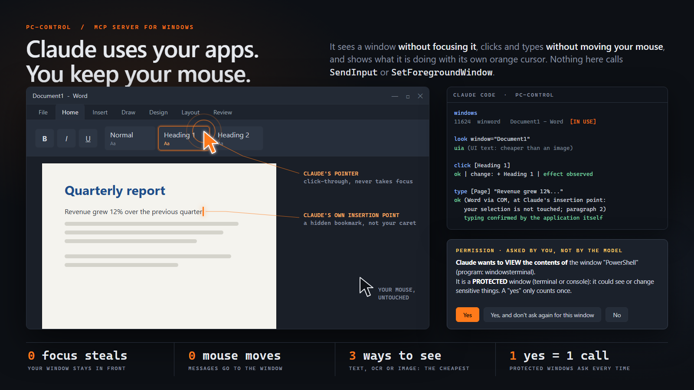

# PC-Control



Let an AI see and operate Windows apps cheaply, **without stealing focus, moving your mouse or typing on your keyboard**.
An MCP server for Claude Code and Codex (and any MCP client). Early version: it works, but expect rough edges.

## Install

You need **Windows 10 or 11**, **64-bit Python 3.10+** and **Claude Code** (or the Codex CLI). In PowerShell:

```powershell
pip install https://github.com/VortexJer/PC-Control/archive/refs/heads/main.zip
pc-control install                      # for Codex: pc-control install --client codex
```

Then open a **new** Claude Code (or Codex) session and ask, for example, *"what do I have open in Word?"*.

> The PyPI package (`pip install claude-pc-control`) is behind (0.7.7): install from GitHub as above to get the current version.

## Update

```powershell
pc-control update
```

## Uninstall

```powershell
pc-control uninstall
pip uninstall -y claude-pc-control
```

`pc-control status` says whether it is installed, connected and paused; `pc-control pause` / `pc-control resume` is the kill switch.

## What it does

- **Sees a window without focusing it.** `look` picks the cheapest of: UI-tree text, OCR text, or an image with numbered marks.
  It never sends empty text, text that costs more than the image, or text that does not cover the window.
- **Acts on a window without focusing it.** Clicks and typing go straight to the control (`BM_CLICK`, `EM_REPLACESEL`, UI Automation patterns...).
  Nothing in the package calls `SetFocus`, `SetForegroundWindow`, `SendInput`, `keybd_event` or `SetCursorPos` (a test scans the code for them).
- **Answers with only what changed** after each action, not the whole screen again, and says whether the action had a visible effect.
- **Does what people ask for, still without focus.** Scroll, read a whole document or page, keyboard shortcuts, drop-downs, find an element (even scrolled out of view) and wait for something to appear.
- **Opens apps out of your way, but where you can watch.** `open_app` starts the app minimized with its button in the taskbar (no focus taken):
  open it whenever you want to see Claude work. Its windows are marked *opened by Claude*, so the model never mistakes yours for its own.
- **Lets you keep working.** You and Claude can use the same app at the same time (see [You and Claude in the same app](#you-and-claude-in-the-same-app)).

<details>
<summary><b>Installation details</b> (what install changes, options, installing from a clone, Codex, older versions)</summary>

**What `pc-control install` changes, and nothing else** (all of it is recorded, so `uninstall` removes exactly that):

| Step | Where |
|---|---|
| Registers the MCP server as **PC-Control** (tools `mcp__PC-Control__*`) | `claude mcp add` (scope `user` by default) |
| Writes the usage skill | `~/.claude/skills/pc-control/SKILL.md` |
| Adds a short managed block pointing to the skill | `~/.claude/CLAUDE.md` (between `<!-- pc-control:begin ... -->` and `<!-- pc-control:end -->`) |
| Registers the permission hooks (`PreToolUse`, `PermissionRequest`) | `~/.claude/settings.json` (backed up once to `settings.json.pc-control-bak`) |
| Keeps a record of all of the above | `~/.claude/pc-control-install.json` |

Options: `--mode follow|auto|ask|strict|bypass` (default `follow`, see [Permission modes](#permission-modes)),
`--scope user|project|local`, `--allow-reads` (let `windows` and `look` run without asking). `pc-control reinstall` repeats the
install with the options recorded last time; `pc-control uninstall --keep-data` keeps the `~/.pc-control` data folder.

**From a clone** (for development): `git clone https://github.com/VortexJer/PC-Control.git`, then run `install.ps1` in it
(options `-Mode`, `-AllowReads`, `-Editable`, `-Client codex`); `update.ps1` and `uninstall.ps1` (`-KeepData`, `-KeepPackage`) do the
same as the commands above.

**Codex:** `pc-control install --client codex` registers the server with `codex mcp add`, installs the skill in
`~/.agents/skills/pc-control` and a managed block in `$CODEX_HOME/AGENTS.md`. Permission requests reach you through MCP elicitation
(if Codex cannot show one, the action is refused). Only user scope; `--allow-reads` is Claude-only. Both clients can be installed at
once; uninstalling one keeps what the other needs.

**Native focus guard:** included in the package (x64, ARM64 and x86 binaries; no compiler needed). The ARM64 build is cross-compiled
and has not been run on ARM hardware.

**Older versions:** `pc-control update` works from any earlier version, including the first one (`pcsight`) and installs made before
the package was renamed from `pc-control` to `claude-pc-control` (0.6). It removes whatever an older version left behind (server,
skill, CLAUDE.md block, hooks, `ask` rules for PC-Control's tools) and only that.

</details>

## Cost

The tool definitions Claude gets on every request are about 1280 tokens for the 10 tools (the `title` that the schema generator adds to every
parameter, 16 % of it, is stripped). With `PC_CONTROL_TRACE=1` each action's answer ends with where its time went (`guards 4ms, cursor 270ms,
settle 250ms, changes 380ms`). Most of an action is the UI Automation walk that tells it what changed; it depends on how fast the app answers
accessibility queries.

`look` chooses by cost: it estimates what the text would cost and what an image of the window would cost (about `ceil(width/28) * ceil(height/28)`
tokens at the size it would send, which adapts to your monitor) and sends the cheaper one, never empty text and never text that does not
cover the window. The text estimate was fitted on real windows against a BPE tokenizer (within about 10 %). After an action it sends
only what changed. In one measured Word window, the UI-tree text cost 713 tokens against 851 for the screenshot; a minimized window is
read as text only. `read` gives a whole document in one call, and `read(find=...)` or `look(find=...)` only the lines or elements you need.

## Permission modes

Pick one with `pc-control install --mode ...` or the `PC_CONTROL_MODE` environment variable.

| Mode | What it does |
|---|---|
| `follow` (default) | Follows Claude Code's own permission mode, as cautious as you chose to be: `bypassPermissions` -> `bypass`, `auto` -> `auto`, `default` / `acceptEdits` / `plan` -> `ask`. |
| `auto` | Filters apps **by category**, no list to maintain: password managers and authenticators, terminals, system administration tools, remote access, crypto wallets, the AI client itself, mail and messaging apps, VPN/security tools, signing/identity apps, developer tools with credentials, and any window whose title is about banking, payments or passwords are *protected*: PC-Control asks you before Claude can use them. Delicate actions (pay, delete, send, install, sign out...) are asked every time. It never types into a password field. |
| `ask` | The lowest-risk mode: **every window** asks. A plain *Yes* is for that call only; *Yes, and don't ask again* remembers that one window for the session. Protected windows ask too. |
| `strict` | `auto` plus: acting only on apps listed in `PC_CONTROL_ALLOW=app1,app2` or `~/.pc-control/allow.txt`. |
| `bypass` | Like `--dangerously-skip-permissions`: no filters, no confirmations. Use it when you trust the session. |

In every mode: creating `~/.pc-control/PAUSE` (or `PC_CONTROL_PAUSE=1`) makes every tool refuse, and `type` needs an element id from `look` (no blind typing).

### Terminals

A terminal is not a window where mouse messages or WM_CHAR work (Windows Terminal draws its own text), but every shell reads its keys from a **console input
buffer**, and that buffer can be written to directly. So `type`, `key`, `read` and `look` talk to the console of the shell itself: no keyboard, no mouse, no
focus, nothing of yours is touched, and the answer shows what the console says afterwards (the typing is *confirmed*, not assumed). It works with classic
console windows and with the tabs of Windows Terminal, including terminals you already had open.

- `type` writes the text; a line break in it presses Enter (it runs). `key` sends enter, tab, esc, arrows, home, end, pgup, pgdn, backspace, delete, ctrl+c.
- Windows Terminal is ONE process for all its windows and tabs. The tab is found through who owns each console, and picked by the window's title; if that is
  not unique the answer lists the candidates instead of guessing, because typing into the wrong shell is worse than not typing.
- The terminal Claude Code itself runs in is never a target (it would type into its own prompt).
- What you type in a terminal runs as you, so these windows stay **protected**: you are asked, and the question shows the full command, also inside `steps`.
- A program running as administrator cannot be reached from a normal process; the answer says so.
### How the questions reach you

Protected windows are **not blocked**; you decide, not the model. The model has no `confirm` flag it could set.

- **Claude Code:** **Claude Code itself shows you its permission dialog** (1. Yes / 2. Yes, and don't ask again / 3. No), and Claude
  cannot answer it. The `PreToolUse` hook (`python -m pc_control.hook`) adds one short sentence, in the language of your Windows, as
  the first parameter of the call (for example *question: "Claude wants to read the whole text of «Terminal» (protected window:
  terminal or console)."*). In Claude Code's normal mode that is all; in its other modes (auto...), where Claude Code might decide
  by itself, the hook answers `ask` so the question is always shown (the dialog then also carries a "Hook ... requires confirmation"
  line). A plain "yes" counts once.
  If you pick Claude Code's "Yes, and don't ask again", PC-Control narrows it to **that one window** for the rest of the session
  (Claude Code saves a per-tool rule; the hook turns it into a per-window approval and removes the rule).
- The `PermissionRequest` hook answers by itself when you do not need to be bothered (a normal window outside the filter, bypass).
  It also tells the server that a dialog really is about to be shown: once Claude Code has done that at least once, the server refuses
  to run a protected action whose dialog was skipped (for example by a "don't ask again" rule), instead of trusting the question.
- **Other MCP clients** (without these hooks): a protected action simply does not run.

## What you see: Claude's cursor

When Claude clicks, an **orange pointer** glides to the element and rings it; when it types, a steady **orange I-beam** slides to the
insertion point. Only one is shown at a time (the one for the last action; each stays at least a moment so a quick action is visible), and it
moves with its window. Both are transparent click-through windows that never take focus. They fade in when Claude starts and **stay visible,
idle at their last position, after it finishes** (`PC_CONTROL_CURSOR=always` default; `user`: only while you are in that window; `off`).
Their colour adapts to what is behind them and they scale with the screen DPI.

The click (or the typing) happens the moment the cursor **arrives**, never before. Speed: `PC_CONTROL_CURSOR_SPEED` for the pointer
(default 1.5) and `PC_CONTROL_CARET_SPEED` for the typing bar (default 3); 1 is the original, slower animation.

The cursor is **isolated to the app it acts on**: it is an owned window of the target, so it follows that window's place in the stacking
order. **Closing the app removes them for good; minimizing it only hides them** and they come back when you restore the window.
When Claude Code closes, the PC-Control server exits with it and takes the cursor away.

## What is re-verified when Claude acts

An element id comes from a `look()`, but the window is alive: between `look()` and the action an id can start pointing at something else
(a Buy / Sell toggle that changed its label, a recycled row of a virtual list, a dialog that reused a control). So nothing is trusted from
the snapshot; every action re-checks, in this order, and refuses with a clear message (`NOT EXECUTED`: look again) when a step fails:

| Step | What is checked, live |
|---|---|
| Handle | The window handle still belongs to the same program that was looked at (handles are reused after a window closes). |
| Exists / where | The control is still there; its position is re-read. After a resize, the only replacement accepted is **one** namesake in the **same container** with the **same id** and not far away: two "OK" buttons are never guessed between. |
| Identity | Its live type and name equal the ones that were looked at (case, spaces and invisible direction marks ignored). Nameless controls compare their id; text fields compare type and id, so typing does not trip it. |
| Window policy | The window's protection category is evaluated again right before dispatching (and after the cursor's trip), and so are the dialogs it opened: a title that became a login or a payment, or a sign-in dialog that popped up, aborts the action so you are asked again. |
| Action policy | "Delicate action" (pay, delete, send...) and "secret field" are judged on the **live** name, id, help text and password flag, not on the snapshot. |

Also guarded, because they act without naming what they act on: clicking by `x,y` (the element of the last look under that point is judged
and must still be itself), `key alt+f4` and the title-bar X on a window Claude did not open (you could lose your work), the clipboard keys
`ctrl+c/x/v` (the clipboard may hold a copied password), and `enter` / `space` in a dialog that offers a delicate button (they press the
default button unseen). Fields that look like secrets (password, PIN, API key, card number, by name, id or help text) are neither typed
into nor read, and `open_app` asks before running interpreters and system tools (python, curl, certutil, reg...) or a script / installer
handed to a launcher. The text `read` returns is marked as data: instructions found in a window or web page are not yours.

Limits that remain: a click by `x,y` with **no** earlier `look()` of that window knows nothing about what is under the point (use ids);
OCR text has no control behind it, so it can only be checked by position; the checks protect against the model misusing PC-Control's tools,
not against a model that can run arbitrary commands as you (it could forge the small approval marks under `~/.pc-control/perm`: keep
Claude Code's own permission for shell and file writes switched on).

## Keeps working when you move or resize the window

Positions are resolved when Claude acts, not when it looked. Moving the window changes nothing (positions are relative to it); resizing
re-lays-out the controls, so each target is re-asked to its live control (or found again by name and type). A click with coordinates from
an old image is refused with a clear message instead of landing somewhere else.

Some changes cannot be absorbed: shrink a window enough and its ribbon collapses, so the button Claude was about to press no longer exists.
Then PC-Control does not guess: it shows a notice on that very window ("If you touch this application, Claude will not be able to act on it. ..."),
waits for you to put it back, and carries on by itself. If a button merely moved, PC-Control finds it again, clicks it and says so in the answer.

## You and Claude in the same app

You can keep working in the app while Claude works in it, as long as you do not hide or move its window:

- **Word:** Claude has its own insertion point (a hidden bookmark that follows the text if you edit before it). It writes there through COM
  and the answer says in which paragraph and after which words. The formatting buttons (bold, italic, alignment...) apply to what Claude
  writes, never to your selection. The Styles gallery (Heading 1, Normal, Strong...) works the same way: a style is Claude's own and is applied only to the new paragraph it starts (never to a paragraph of yours; if the text lands in one of yours, the answer says so). In Word `key` only offers `enter`, `space` and `backspace`, acting at Claude's own insertion point.
- **Independence:** Claude does not act as a keyboard or mouse. It asks the app to do things through its own interfaces (UI Automation
  patterns, the Java Access Bridge, Scintilla's API, COM in Office), so your typing and your mouse elsewhere never wait for Claude and
  never mix with it. While you type or drag in ANOTHER window, Claude's actions go out at once. One thing is shared by Windows itself and
  was measured: the state of held modifiers. While you hold Shift/Ctrl/Alt/Win, a background app sees them held, so a message-based key
  or click from Claude would become a Shift-click or a shortcut; only in that case Claude waits, the milliseconds until you let go.
- **Your mouse:** a drag of yours inside the very window Claude is acting on is never broken: Claude waits for you to release it.
- **Your keyboard:** in the window you are typing in, message-based keys wait for a quiet interval, so they do not land in your word.
- **Text fields:** native edits append at the actual end of the document and restore the prior selection if no new real input arrived meanwhile. Accessible fields use `ValuePattern.SetValue` or `LegacyIAccessible.SetValue` without focusing them. An unsupported explicit target is refused; PC-Control never focuses it or redirects the text to another field. A field you are actively editing yields to your input.
- **Modern RichEdit editors (including Notepad):** writes use the editor's Text Object Model when available, through a separate text range; no selection command is sent. EOF positions are resolved by the editor, including Unicode and line breaks. A COM write whose outcome cannot be confirmed is reported as unconfirmed and is not retried through a second backend.
- **Keys in RichEdit documents:** Enter and Space append through ranges. Movement/deletion keys refuse to modify the user's caret; an open dialog/menu must be targeted explicitly. Other key routes verify that the focused control belongs to the requested window or its owned dialog, even when two windows share a GUI thread. Ambiguous Chromium input hosts are not guessed.
- **Right click** opens the app's real context menu, which closes with any click of yours, so Claude only opens it when you have been idle
  for a few seconds and no menu is open. Menu entries are pressed through UI Automation patterns (by id, like any button).

## Apps without a normal UI tree

- **Java (Swing/AWT, Oracle Forms, SQL Developer, JMeter...):** read and operated through the Java Access Bridge: named buttons, fields,
  check boxes, combos, menus (also closed ones), tabs and tables, without focus, mouse or keyboard. Apps that `open_app` starts get the
  bridge for that process only; for apps you start yourself, `pc-control java enable` turns it on for your user (`status`, `disable`).
  A Java window without the bridge is read from its pixels and the answer says how to turn the bridge on.
- **Remote Desktop and virtual machines (mstsc, Windows App, Citrix, VMware, VirtualBox, Hyper-V, VNC...):** the window is a picture of
  another computer, so it is read with OCR (also while covered) and operated with input messages to the client's own input window; the
  client is only TOLD it is active (messages), Windows' real focus does not move. Typed text becomes key positions of your keyboard
  layout, including AltGr and dead keys. Limit: inside the remote computer this IS keyboard/mouse input, because that is all a remote
  session accepts; for full independence there, run PC-Control inside the remote machine.
- **Scintilla editors (Notepad++, SciTE, Notepad2/3, Code::Blocks...):** invisible to UI Automation; read, written and scrolled through
  Scintilla's own message API. Text is appended at Claude's own point (the end of the document), your caret and selection stay put.
- **32-bit apps:** guarded like 64-bit ones through a small 32-bit helper (`focus_guard_host32.exe`).
- **Pixel verification:** on canvases, OCR targets, Java without the bridge and remote screens, a click or key is checked against the
  pixels at the target: a real change is reported as seen, an action that changed nothing is reported as `NO VISIBLE EFFECT`, never `ok`.
- **No loops:** the same call failing the same way twice gets an explanation of what to do instead; a third identical attempt is refused
  without acting until the window changes.

## Tools

| Tool | What it does |
|---|---|
| `windows` | Lists windows, most recent first (`filter="word"` lists only the matching ones: 12 tokens instead of ~150); marks `[IN USE]` (where you work now), `[LAST USED]`, `[PROTECTED: ...]` / `[ASKS]`, `(minimized)`, `(hidden)` and `[mine]` (opened by Claude). A Store app is listed once. A title that matches several windows is never guessed: the answer lists them with their number. |
| `look` | Sees a window: UI-tree text, OCR text or an image with numbered marks, whichever is cheapest that works. Text fields show what they contain (never password fields). `find="Save|Cancel"` returns only the matching elements, also those scrolled out of view; `find="!Loading"` with `wait=10` waits until that text is gone. |
| `click` | Clicks an element by id or by its exact name (several with that name: the ids are listed instead of guessing), or `x,y` of the last image; `right` and `double` supported. Ids stay valid between looks. Title-bar buttons (minimize, maximize, close) and elements of apps that ignore mouse messages are pressed through UI Automation. |
| `type` | Types into an element id (append, or `replace`) and reads the field back to confirm the text is really there. On a drop-down or list (classic, WinForms, web `<select>`) it picks the entry with that text, and the app's change event fires. In Excel the target can be a cell address (`B3`, `Sheet2!A1`): numbers stay numbers, `=...` is a formula, and the answer says what the cell now shows. |
| `drag` | Holds the button and drags through points (freehand, line, rectangle, ellipse) using mouse messages: no real mouse, no focus. Apps with modern canvases may ignore it. |
| `key` | A key (`enter`, `tab`, `esc`, arrows, `f1`-`f12`...) or a shortcut (`ctrl+s`, `ctrl+shift+n`, `alt+f4`). Shortcuts never press real keys: PC-Control runs the app's own menu command that shows that shortcut, the element declaring it, or the text-box command (`ctrl+a/c/x/v/z`). If the app has no such command, the answer lists the shortcuts it does have (they depend on its language: in Spanish Notepad, Save is `Ctrl+G`). |
| `scroll` | Scrolls the window or an element by pages, or to the top/bottom, through UI Automation, scroll-bar messages or wheel messages: no focus, no mouse. Says the position before and after. |
| `read` | The whole text of a document, web page, editor or field, also what is scrolled out of view, in pieces (`start`, `length`), or only the lines that match (`find="a|b"`, numbered). Much cheaper than scrolling and looking. In Excel, the cells of the sheet (tab-separated, with row numbers and column letters). In PowerPoint, every slide's text, tables and speaker notes. Never reads password fields. |
| `show` | Shows **you** where something is: an orange outline that follows the element's shape (a circle for small icons and check boxes, a rounded rectangle for the rest; by id, name or `x,y`) with an optional label, above its window, never clicking. It goes away when you click there, when that spot changes (you did it), or after a few seconds. For "where do I click to...?". |
| `wait_for` | Same circle as `show`, but **waits** until you click it (or the spot changes) and then answers `clicked`, `changed` or `timeout`, so Claude can walk you through several steps one after another without guessing when you are done. |
| `steps` | Runs up to 12 actions (click, type, key, scroll, read, look, wait) on one window in a single call, much faster than one call each. It stops at the first step that fails, has no visible effect or needs your permission; sensitive steps still ask you one by one. |
| `open_app` | Launches an app minimized with its taskbar button, so you can open it and watch, in its own folder (as a shortcut does). If the window belongs to a process the launcher starts (Windows Media Player, Git GUI) or to a Store app, it is found and minimized too, and if it grabbed the focus it is handed back to you. Browsers (Edge, Chrome, Brave...) open behind your windows instead, not minimized, because a minimized browser hides its page from accessibility; the focus is never taken. `hidden=true` uses an invisible desktop, only when you ask for it. `behind=true` opens it NOT minimized but behind every window of yours, for apps that do not work minimized (browsers, some Store and Chromium apps): the window is sent to the very back the instant Windows creates it, so it is not drawn over what you are doing (0 ms on most apps, a few frames on some) and, on most apps, it does not take the keyboard focus. It returns in about half a second; if an app takes the focus anyway the answer says so. |

## Adapts to your PC

- Cursor and caret scale with the DPI of the window they point at (100-300 %, per monitor).
- Screenshots adapt to the monitor the window is on (about 55 % of its long edge, between 768 and 1344 px, never upscaled).
- OCR uses your Windows languages (falls back to English/Spanish, and to images if there is none).
- Delicate-action and sensitive-window detection knows English, Spanish, French, German, Italian and Portuguese; protected app
  categories are matched by process name, which is language independent.
- Multi-monitor setups and negative coordinates are handled.

## Known limits

- A browser or Electron app that is minimized hides its page: PC-Control says so instead of answering "not found". Browsers opened with `open_app` are placed behind your windows for that reason.
- Excel and Word are reached through COM from their own window: Claude writes cells by address and text at its own insertion point, never through your selection. While you are editing a cell Excel refuses COM calls; PC-Control retries for a few seconds and then says so. Save (`ctrl+s`, or `ctrl+g` in a Spanish Office, where `ctrl+s` is underline) only works for files that already have a name.

- Shortcuts work only where the app exposes them as a command (a classic menu, a menu entry or element with that shortcut, or a text box). Modern menus (WinUI, WPF) only exist while open, so they are searched only for apps on the hidden desktop: opening them on your desktop could take the focus.
- Windows running as administrator cannot be read from a normal process (Windows blocks it).
- Modern Store/XAML apps (Calculator, Paint, Settings) may ignore background mouse messages. For buttons, PC-Control can use UI Automation patterns. These patterns are app-provided and are not a universal focus-isolation guarantee. The modern Paint canvas ignores background drags: PC-Control now refuses that unsupported operation instead of reporting a successful stroke. Other canvases still require visual verification.
- Some apps ignore "start minimized". A native, thread-specific CBT guard now vetoes programmatic activation/focus changes in compatible target threads, rather than restoring focus after it was stolen. It distinguishes top-level windows sharing a process, while allowing their own dialogs and user activation. A temporary, thread-specific message hook confirms delivery with a tagged `WM_NULL` heartbeat; it inspects no keyboard/mouse contents and is removed immediately. Startup GUI-queue initialization, new broker processes, protected apps and architecture differences still limit coverage; this is not a universal guarantee for every app.
- Chromium browsers (Chrome, Edge) and Electron apps expose the page contents only while their accessibility support is on; if a page shows only the browser's own controls, start it with `--force-renderer-accessibility`. Web fields are filled through UI Automation (no focus), and web buttons and checkboxes are pressed the same way.
- Apps without an accessibility tree rely on OCR; apps that draw everything themselves (some games) may need images.
- A minimized window is read through its UI tree only: no screenshot, no scrolling, no clicks by coordinates (it would have to be shown).
  Open it from the taskbar when that is needed.
- Store (UWP) apps cannot run on a hidden desktop.
- Background `WM_CHAR` typing is not accepted by every app. Targeted typing uses native editor messages or writable accessibility value patterns, including the modern Notepad editor. Fields that expose neither are refused rather than focused.
- Protected/incompatible target processes may refuse the native hook. Guarded actions then refuse instead of silently using an unprotected fallback. Startup aliases that hand off to another process require monitoring and are not guaranteed race-free. The visible tests record transient foreground/focus events as well as final state.

The [input limitations audit](docs/INPUT_LIMITS.md) records what was fixed, what was tested in real visible windows, and what remains unsupported. It does not claim independent input support in every Windows application.

## Tests

The tests never touch your real apps: they use throw-away windows (off screen or on a hidden desktop) and a simulated Word. `test_cursor`
shows the orange cursor for a few seconds. Run them one by one:

```powershell
python tests/test_decide.py       # cost/quality rules
python tests/test_static.py       # no intrusive API calls in the package
python tests/test_background.py   # clicks and typing without focus
python tests/test_hidden.py       # hidden desktop: never on your screen
python tests/test_taskbar.py      # minimized + taskbar button: never on your screen
python tests/test_tuck.py         # when a new window is (not) sent behind
python tests/test_server.py       # MCP server end to end, with its safety rules
python tests/test_policy.py       # permission modes and categories
python tests/test_hook.py         # the permission hooks
python tests/test_cursor.py       # the orange cursor (shows it for a few seconds)
python tests/test_mark.py         # show(): the circle is above its window and goes away when that spot changes
python tests/test_resize.py       # moving / resizing the window mid-action
python tests/test_word.py         # Word: Claude's own insertion point (simulated Word)
python tests/test_input_share.py  # you and Claude working in the same app
python tests/test_modern_input.py # focused-target refusal, value-pattern fallbacks, preserved selections and drag limits (simulated controls)
python tests/test_richedit.py     # independent ranges, Unicode/line breaks, COM errors and no unsafe retry (simulated document)
python tests/test_focus_guard.py  # real visible app: 24 startup + 24 runtime activation/focus attempts; WinEvent observer
python tests/test_focus_safety.py # no acknowledgement => no mutation; partial hooks removed (simulated failures)
python tools/visible_input_demo.py # visible real Win32 edits/canvas; nonactivating, ordinary window; foreground/focus events monitored
python tools/probe_modern_input.py notepad --exercise # visible disposable document in the installed modern Notepad
python tools/probe_modern_input.py mspaint --exercise # visible disposable bitmap; compares canvas pixels and reports the unsupported drag
python tests/test_drag.py         # drag / draw
python tests/test_menu.py         # menu entries pressed through accessibility
python tests/test_menu_real.py    # ... against a real Windows menu
python tests/test_more.py         # scroll, read, shortcuts, drop-downs, find and wait
python tests/test_excel.py        # Excel: read and write cells, formulas, save (skipped without Excel)
python tests/test_powerpoint.py   # PowerPoint: slides and notes (skipped without PowerPoint)
python tests/test_web.py          # the same on a real web page in Edge (skipped without Edge)
python tests/test_unnamed_field.py # fields and buttons without an accessible name still get an id
python tests/test_launcher.py     # a launcher whose window belongs to a child process: found, minimized, focus kept
python tests/test_identity.py     # what is re-verified before acting (mocks + a real Buy/Sell toggle)
python tests/test_fuzz.py         # 59 bad or odd inputs through the real protocol: clear answers, no crashes
python tests/test_cli.py          # install / uninstall / status / pause, the package rename and its migration
python tests/test_hidden_cleanup.py   # apps on the hidden desktop end with the session (shutdown, kill, leftovers of older versions)
python tests/test_guard_descriptor.py # every tool has an inherit/review decision for HOL Guard (fails when a new tool has none)
python tests/test_back_on_create.py # open_app(behind=true): at the very back, not minimized, no focus taken, fast
python tests/test_hang.py         # a call stuck inside another program (Firefox on a huge page) does not freeze the server
python tests/test_terminal.py     # terminals: type, key, read and look through the console; the right tab; never the terminal Claude Code runs in
python tests/test_steps.py        # steps: several actions in one call, stops on failure or permission
python tests/test_lifecycle.py    # the server exits with Claude Code (EOF or abrupt death), whether launched as a module or as pc-control-mcp
python tests/test_hygiene.py      # license, README, no personal data
```

### HOL Guard

[HOL Guard](https://github.com/hashgraph-online/hol-guard) lists PC-Control in `contributions/mcp-servers/mcp.pc-control.json` (in its repository): which
tools it should ask about (`review`) and which it can let through (`inherit`). When a tool is added here that list goes stale, so it is generated from
the live server. The one decision per tool lives in `tools/guard_descriptor.py`; a new tool is `review` until it is classified there, and
`tests/test_guard_descriptor.py` fails until it is.

```
python tools/guard_descriptor.py --guard-repo PATH_TO_HOL_GUARD            # show what would change
python tools/guard_descriptor.py --guard-repo PATH_TO_HOL_GUARD --check    # exit 1 if it is out of date (release checklist)
python tools/guard_descriptor.py --guard-repo PATH_TO_HOL_GUARD --write    # update it and run Guard's own trust check
```

It only rewrites the tool list, the "keep ... on review" sentence and the pinned version. It never opens a pull request: sending the change to
Guard is a human decision.
## Tested with

Besides the throw-away test windows: Word, Excel, PowerPoint, Notepad, File Explorer, Edge (web pages), Calculator, Paint, Settings,
KiCad, OBS Studio, RStudio, VS Code, Git GUI, Character Map, Windows Media Player and Clock, driven by Claude and by a cheaper model
(Haiku) as a test user, whose reports fixed most of the 0.4 issues.

## Demo

`python tools/demo.py` opens a small test window on your screen (it does not take the focus) and shows, with Claude's orange
cursor and a caption for each step: picking in a drop-down, scrolling, finding an entry out of view and clicking it, a shortcut run
through the app's menu, and reading the whole text. Then it closes the window.

## Diagnostics

`python tools/token_bench.py [other_checkout]` runs a fixed scenario through the MCP protocol and counts the tokens of the tool
definitions and of every answer (needs `pip install tiktoken`), to compare two versions before and after a change.

`python tools/input_monitor.py out.log stop.flag` logs focus changes, new windows, the desktop that receives input, mouse clipping and
capture, so you can check that PC-Control never takes your focus or input.

## License

MIT

## Disclaimer

PC-Control lets an AI assistant operate your computer. The creator of this tool is not responsible for any action Claude (or any other
model) takes through it, nor for its consequences. Nor is the creator responsible for bugs, errors or unexpected behavior of the tool
itself (a click or keystroke that lands on the wrong element, a protection that fails, lost or modified data, and so on). The permission
system reduces risk, it does not remove it. By using PC-Control you accept all the risks, including those of errors in the tool: review
what you allow, keep backups of anything important, and use it at your own risk. The software is provided "as is", without warranty of
any kind, as stated in the MIT license.
